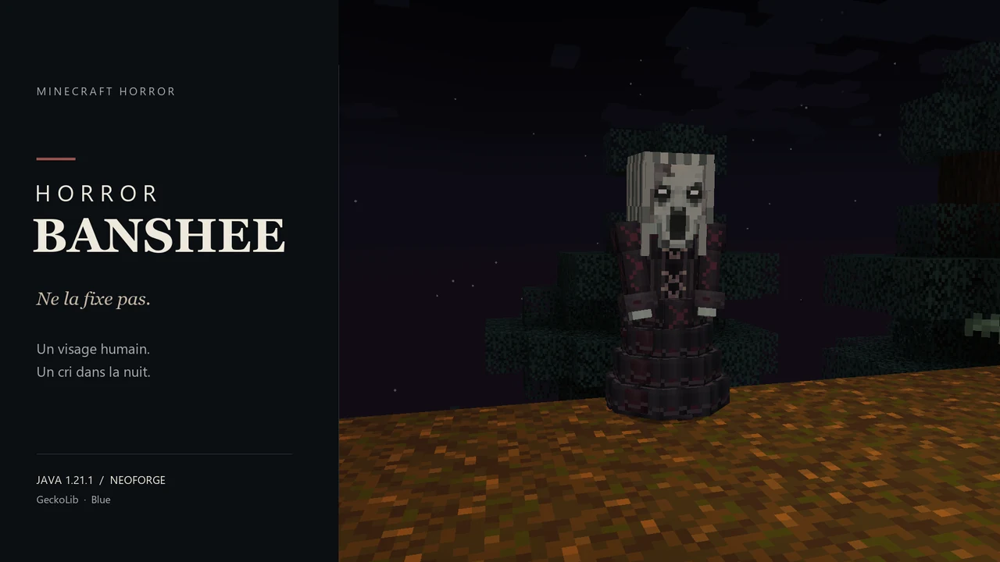

  

# Horror Banshee

**Ne la fixe pas. / Don't stare.**

Une femme seule entre les arbres. Un visage qui change l'espace d'un instant.
Des pleurs, une course frénétique, puis un cri avant la chasse.

Horror Banshee est un mod d'horreur pour **Minecraft Java 1.21.1**, sous
**NeoForge**, avec des personnages originaux et des animations **GeckoLib**.

[**Lire le wiki complet**](wiki/Home.md) · [**Voir la galerie**](wiki/Galerie.md)
· [Description FR](description-fr.md) · [English description](description-en.md)

## Ce qui vous attend

- **Trois visages humains**, des transformations irrégulières et une chasse rapide.
- **La Matriarche**, une apparition rare en robe 3D, avec vol bas, cri et souffle.
- **Les grandes taïgas hantées**, leur brume et leurs rares murmures.
- **La Crypte des Banshees**, creusée dans la montagne près de l'eau.
- **Larmes, potions et essence de vie**, pour emprunter les pouvoirs de la créature.

| Une femme ordinaire | Sa vraie nature |
| :---: | :---: |
|  |  |

## Guide du joueur

| Pour commencer | Pour aller plus loin |
| --- | --- |
| [Installation et compatibilité](wiki/Installation.md) | [La Matriarche](wiki/Matriarche.md) |
| [Déroulement d'une rencontre](wiki/Rencontres.md) | [Crypte des Banshees](wiki/Crypte.md) |
| [Les trois Banshees](wiki/Banshees.md) | [Forêts hantées](wiki/Forets-hantees.md) |
| [Potions et recettes](wiki/Potions.md) | [Essence de vie et vol](wiki/Essence-de-vie.md) |
| [Objets et probabilités de butin](wiki/Objets-et-butin.md) | [Voix et ambiance](wiki/Audio.md) |
| [Commandes de test](wiki/Commandes.md) | [FAQ et dépannage](wiki/FAQ-et-depannage.md) |

## Compatibilité

Version documentée : **0.11.1**.

| Prérequis | Version |
| --- | --- |
| Minecraft | **Java Edition 1.21.1** |
| NeoForge | **21.1.256** ou version compatible de la branche 21.1 |
| Java | **21** |
| GeckoLib | NeoForge 1.21.1, **4.9.3** testée |
| Installation | Client **et** serveur |

Ce dépôt accueille le **wiki**, les **descriptions** et les **visuels**.
Les liens CurseForge/Modrinth seront ajoutés lors de la publication du mod.
Aucun téléchargement du JAR n'est encore proposé ici.

## About the mod

A harmless-looking woman, a fleeting glimpse of something wrong, sobbing,
frantic movement, and a scream before the hunt. Discover three human disguises,
the rare flying Matriarch, mountain crypts, haunted taiga and nocturnal relics.

[Read the full English description](description-en.md).
The detailed player wiki is currently in French.

## Retours et crédits

[Signaler un problème](https://github.com/blueez93/Banshee/issues)
· [Historique](wiki/Changelog.md) · [Crédits](wiki/Credits-et-licence.md)
· [Licence](LICENSE)

Les captures proviennent réellement du mod, sans shaders. Les scènes sont
composées pour la présentation ; les règles de génération et de spawn sont
documentées dans le wiki. Les bannières associent ces captures à une mise en page.

Projet : **Blue / blueez93**. **All Rights Reserved**.
