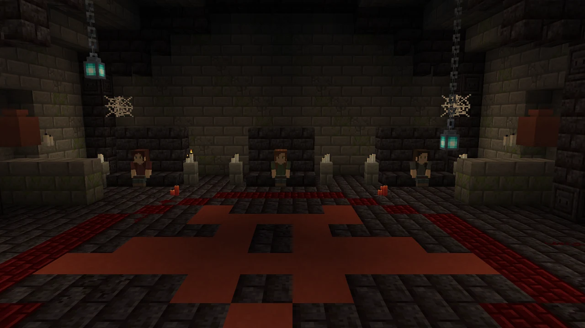
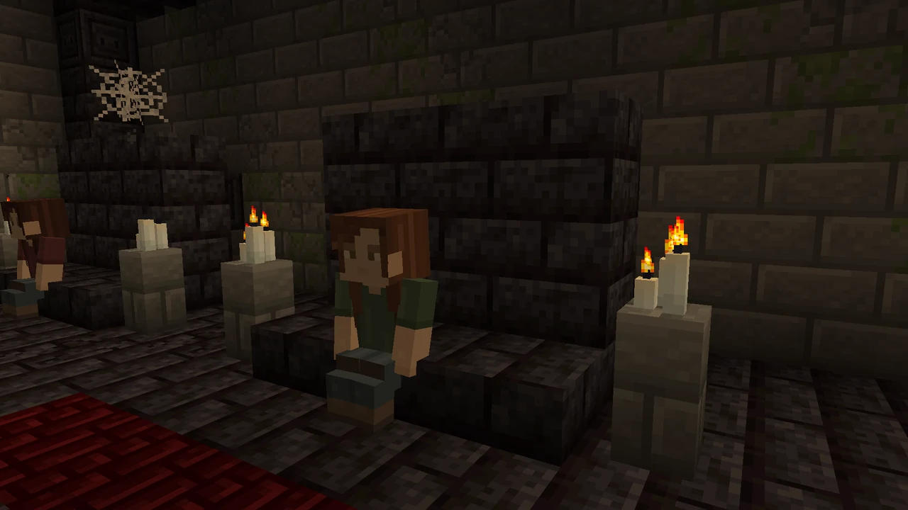

# Crypte des Banshees



La Crypte des Banshees est une structure rare de l'Overworld. Elle se creuse
dans un flanc de montagne et exige une étendue d'eau naturelle à proximité,
devant son entrée. Elle est intégrée à la génération des **nouveaux chunks**.

## La trouver

Chercher une montagne au bord d'un lac ou d'une rivière est une piste, pas une
garantie. Le relief doit permettre d'enfouir la salle et de conserver une entrée
praticable. Les sites qui exposeraient trop la construction ou demanderaient de
longues fondations sont rejetés.

Avec les commandes activées :

```mcfunction
/locate structure horrorbanshee:banshee_crypt
```

Le mod lance cette recherche en arrière-plan et confirme son démarrage dans le
chat. Il peut afficher un avancement toutes les cinq secondes. Une seule
recherche peut fonctionner à la fois. Elle s'arrête au bout de 90 secondes si
aucun site n'a été trouvé : essayer depuis un autre endroit plutôt que relancer
la commande en boucle.

## À l'intérieur

- Une salle voûtée et des sépultures.
- Des chaînes, lanternes d'âme, bougies et toiles d'araignée.
- Un motif rituel incrusté dans le sol, avec de petites traces de redstone.
- **Trois femmes assises**, une pour chaque variante ordinaire.

Les blocs sont des blocs vanilla. Le décor n'ajoute pas un système de magie
rituelle ou de progression : le cercle est visuel.

Une habitante se lève lorsque sa rencontre est déclenchée par clic droit, coup
ou regard prolongé. Les deux autres restent assises. Les habitants sont créés
à la génération de la structure ; il n'y a **pas de spawner** et ils ne
réapparaissent pas automatiquement après leur mort.



## Génération

La structure nécessite un monde normal de l'Overworld et la génération des
structures activée. Les cryptes ne sont pas ajoutées dans les chunks déjà
générés. La proximité de l'eau est vérifiée jusqu'à 96 blocs, avec des contrôles
de relief et de couverture. Les paramètres de placement proposent des
candidats ; la rareté finale n'est donc pas un pourcentage fixe par montagne.

Les générateurs de terrain et datapacks qui modifient fortement l'Overworld
peuvent changer l'emplacement et la disponibilité des sites.

[Accueil](Home.md) · [Rencontres](Rencontres.md) · [Dépannage](FAQ-et-depannage.md)

---
[Accueil du wiki](Home.md) · [Installation](Installation.md) · [Galerie](Galerie.md) · [Commandes](Commandes.md)
