# Galerie de Horror Banshee

Captures du vrai mod dans Minecraft Java 1.21.1, sans shaders. Les portraits
et les cryptes montrent la version 0.11.1 ; la section brouillard reprend les
captures de validation de la Phase 4A (0.7.0). Les scènes composées ne
représentent pas des probabilités de rencontre.

## Visuels de présentation à réutiliser

- [Couverture française, 1920×1080](../artwork/cover-fr-1920x1080.png)
- [Couverture anglaise, 1920×1080](../artwork/cover-en-1920x1080.png)
- [Bannière bilingue, 1920×640](../artwork/banner-1920x640.png)
- [Couverture carrée, 1024×1024](../artwork/cover-square-1024.png)
- [Présentation des reliques, 1600×900](../artwork/reliques-1600x900.png)
- [Comparatif du brouillard, 1920×580](../artwork/brouillard-comparatif-1920x580.png)

Les captures originales en PNG sont disponibles dans le dossier
[screenshots](../screenshots/). Les images affichées ci-dessous sont les copies
WebP allégées pour la lecture du wiki.

## Le brouillard des forêts hantées

Le mod ajoute une atmosphère hantée à certaines grandes taïgas vanilla.
Il ne s'agit pas d'un nouveau biome nommé « Banshee » : le brouillard apparaît
progressivement dans les zones concernées.

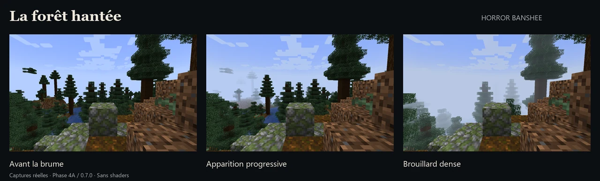

Captures natives de validation de la Phase 4A (0.7.0), même point de vue,
sans shaders ni ajout de brume en retouche. Les originaux conservent leur
résolution **1280×800**.

### Avant l'apparition
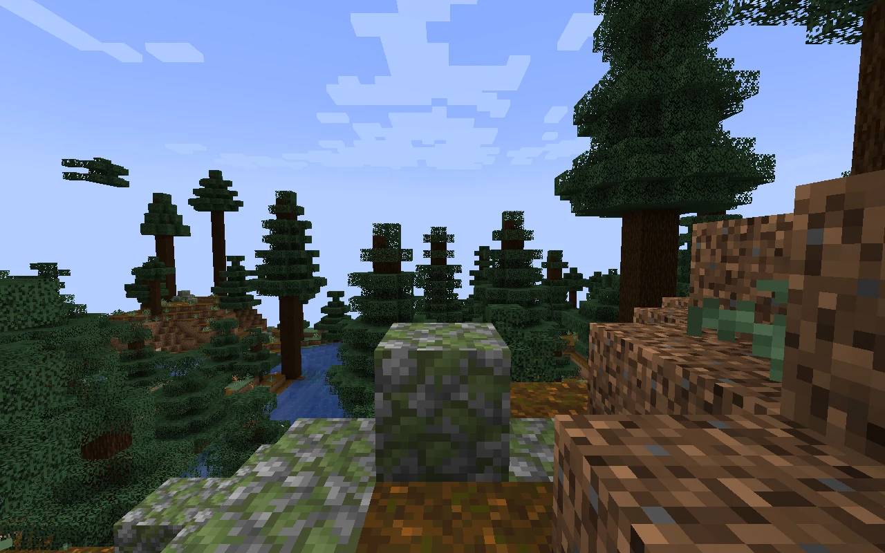
[Original PNG](../forest-screenshots/12-forest-before.png)

### Apparition progressive
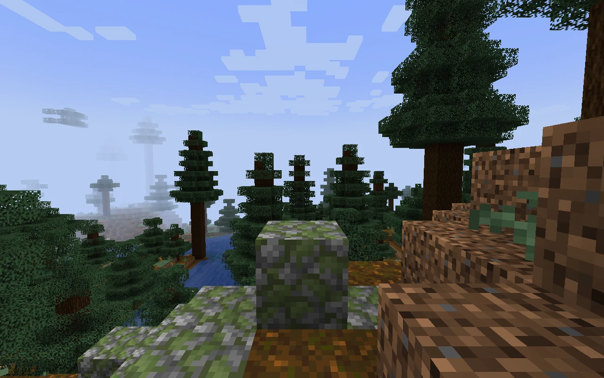
[Original PNG](../forest-screenshots/13-forest-progressive.png)

### Brouillard dense
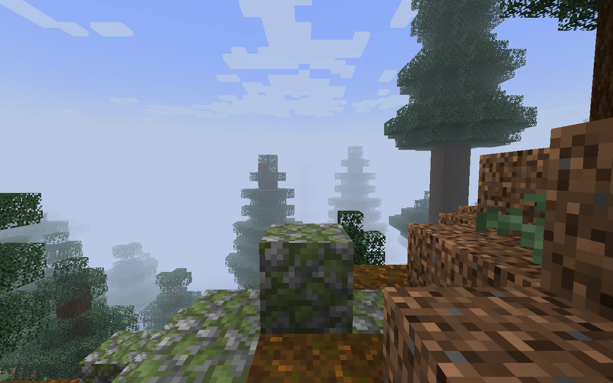
[Original PNG](../forest-screenshots/14-forest-dense.png)

[Fonctionnement des forêts hantées](Forets-hantees.md)

## Une présence dans la forêt
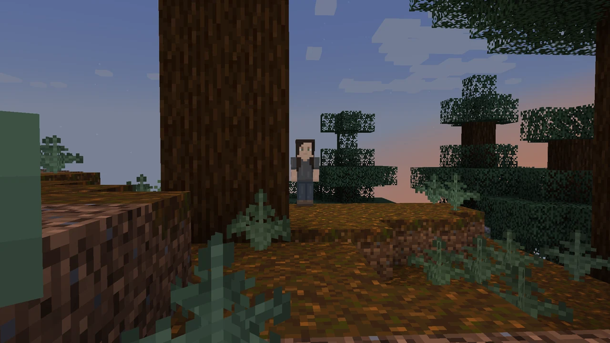

## Le déguisement humain
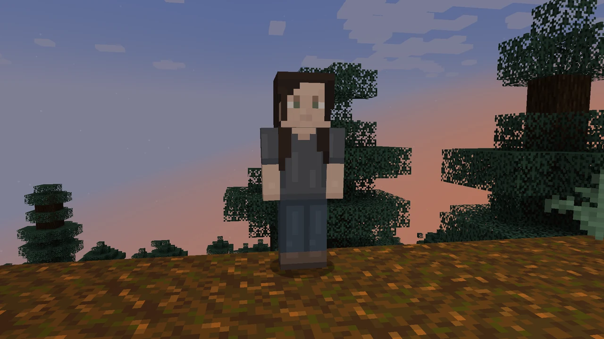

## Le visage révélé
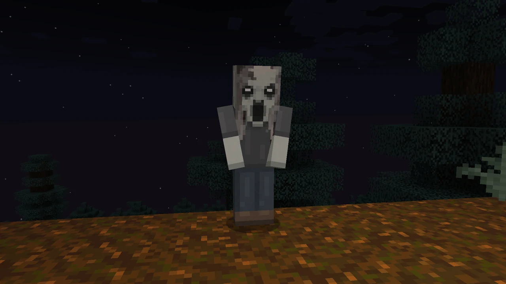

## Trois femmes, la même menace
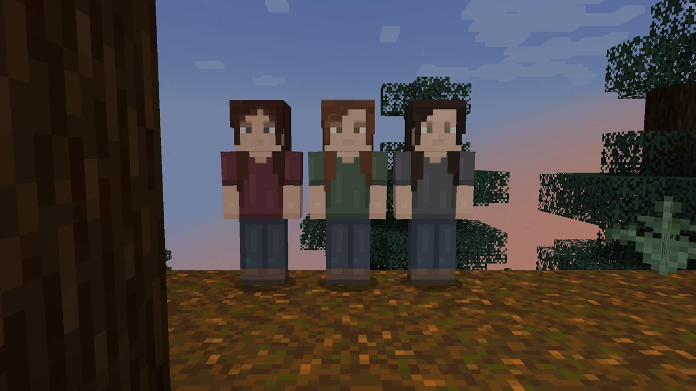

## La Matriarche avant la révélation
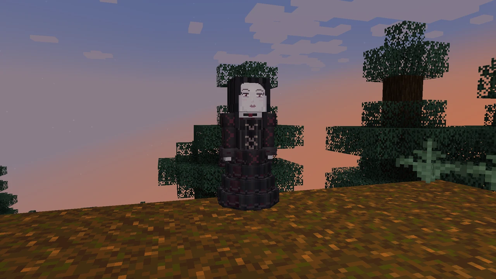

## La Matriarche révélée
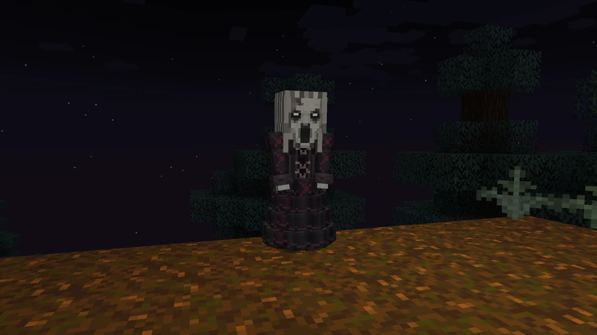

## Son cri et sa lévitation
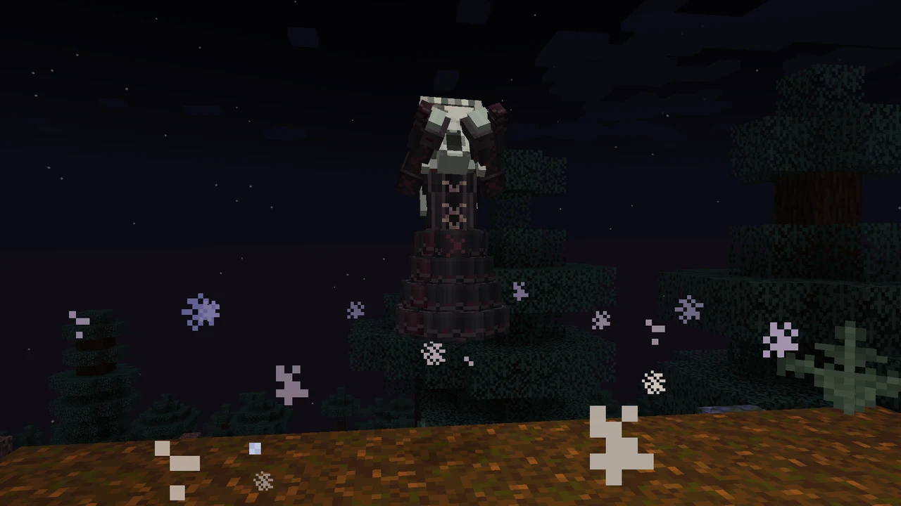

## Une crypte intégrée à la montagne
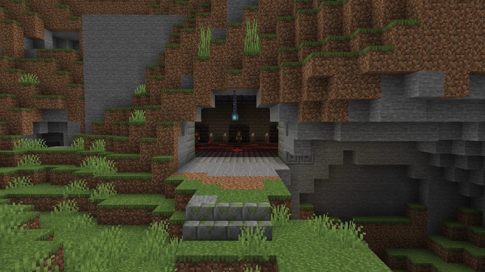

## La salle intérieure

## Les habitantes assises

## Le rituel au sol
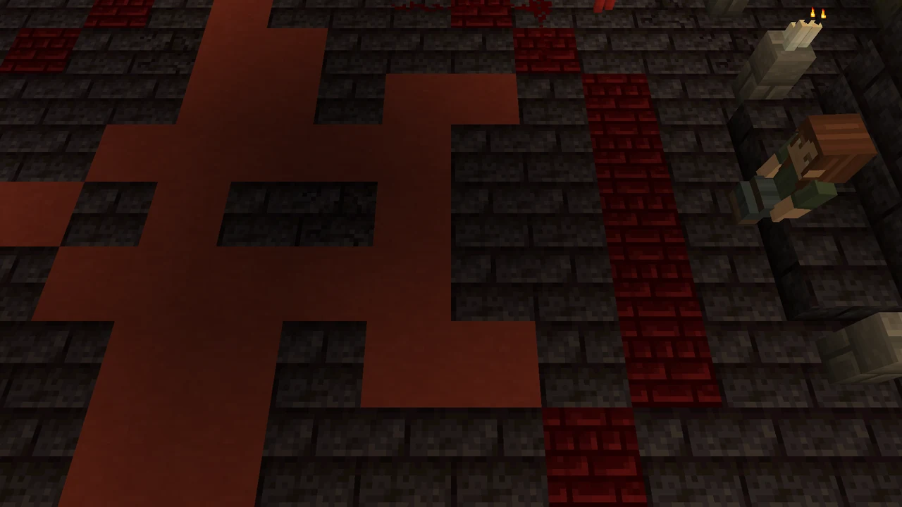

[Accueil](Home.md) · [Crédits des images](Credits-et-licence.md)

---
[Accueil du wiki](Home.md) · [Installation](Installation.md) · [Galerie](Galerie.md) · [Commandes](Commandes.md)
