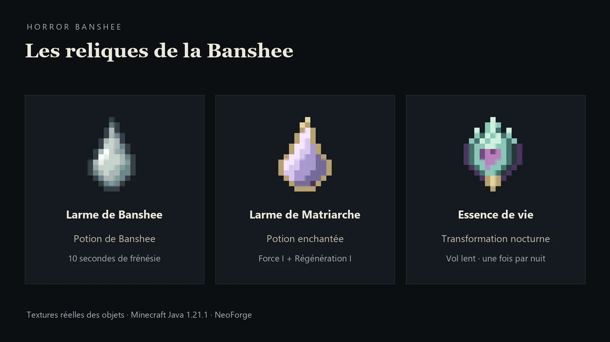

# Objets et butin

## Catalogue

| Objet | Identifiant | Fonction |
| --- | --- | --- |
| Larme de Banshee | `horrorbanshee:banshee_tear` | Ingrédient de potion ordinaire |
| Larme de Matriarche | `horrorbanshee:matriarch_tear` | Ingrédient légendaire de potion enchantée |
| Potion de Banshee | `horrorbanshee:banshee_potion` | Transformation brève, course rapide |
| Potion de Banshee enchantée | `horrorbanshee:enchanted_banshee_potion` | Apparence Matriarche, Force I, Régénération I |
| Essence de vie de banshee | `horrorbanshee:banshee_life_essence` | Objet permanent de vol nocturne |
| Œuf de Banshee | `horrorbanshee:banshee_spawn_egg` | Apparition pour le mode Créatif et les tests |

La larme de Matriarche et l'essence ont une apparence scintillante et une
mention « Légendaire ». Le mod utilise pour cela la rareté vanilla maximale
`EPIC`, sans ajouter une mécanique de niveaux de rareté. Les larmes se rangent
par 64 ; les potions et l'essence par un.

## À la mort d'une Banshee ordinaire

| Récompense | Chance | Quantité |
| --- | --- | --- |
| Larme ordinaire | **20 %** | 1 |
| Essence de vie | **1 %** | 1 |

Ces deux tirages sont indépendants : une même Banshee ordinaire peut, très
rarement, donner les deux objets.

## À la mort d'une Matriarche

| Récompense | Chance | Quantité |
| --- | --- | --- |
| Larme de Matriarche | **90 %** | 1 |
| Essence de vie | **10 %** | 1 |

Il s'agit d'un choix exclusif : une Matriarche admissible donne **exactement
l'un des deux**, jamais les deux et pas une larme ordinaire à la place.

## Conditions du butin de mort

La créature doit avoir atteint sa forme **BANSHEE** révélée, sa mort doit être
attribuée à un joueur et `doMobLoot` doit être activé. Tuer une femme encore
humaine ou employer simplement `/kill` ne remplace pas ce combat pour le butin.
Les pourcentages indiqués ne bénéficient pas d'un bonus Looting ajouté par le mod.

## Larmes laissées pendant les pleurs

Toutes les variantes, Matriarche comprise, ont **20 % de chance par rencontre**
de laisser tomber **1 à 3 larmes ordinaires** pendant les pleurs et la course.
Les 80 % de rencontres restantes n'en laissent aucune à ce moment-là.

La première tombe après environ 1,5 à 2,5 secondes ; les suivantes sont espacées
de 2 à 3 secondes. Ce sont de vrais objets ramassables pour l'alambic.
Le tirage et les quantités restantes sont sauvegardés, sans nouveau tirage à
chaque clic ou rechargement. La forme finale ne continue pas à en produire.
Ces drops respectent aussi `doMobLoot`.

[Accueil](Home.md) · [Potions](Potions.md) · [Essence](Essence-de-vie.md)

---
[Accueil du wiki](Home.md) · [Installation](Installation.md) · [Galerie](Galerie.md) · [Commandes](Commandes.md)
